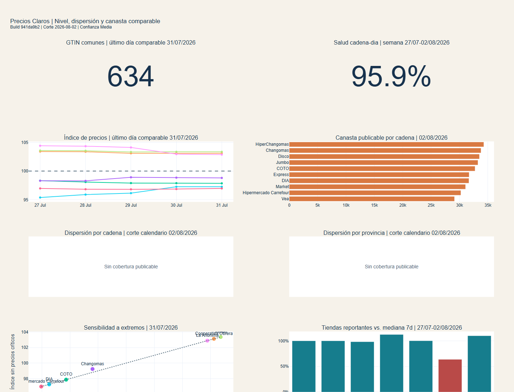
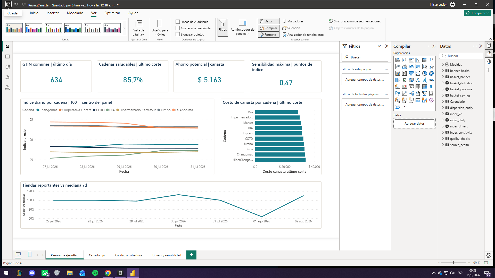
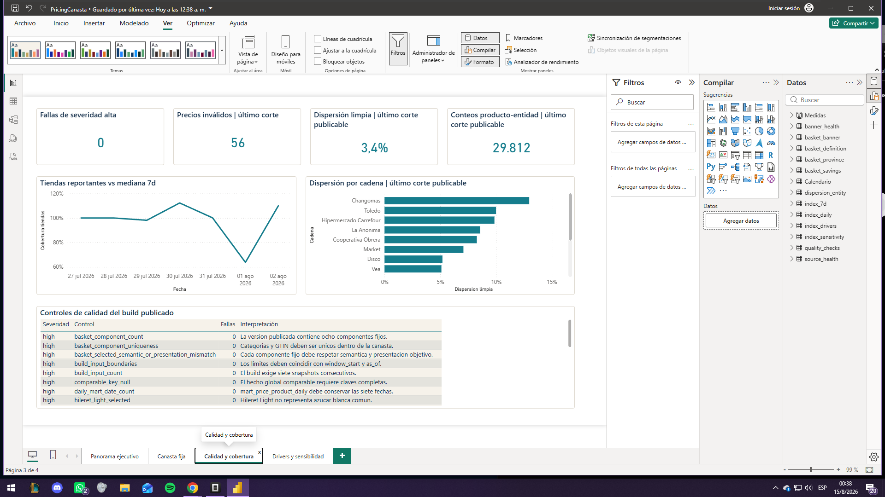

# Supermarket pricing and comparable basket

[](https://github.com/alexanderhuth98/pricing-canasta-supermercado/actions/workflows/ci.yml)
[](https://alexanderhuth98.github.io/pricing-canasta-supermercado/)
[](LICENSE)

[Versión en español](README.md)

End-to-end Data Analytics portfolio project built from Argentina's official
**Precios Claros - SEPA** national snapshots. It matches exact products, applies
publication gates, and delivers reproducible web and Power BI views.

[Dashboard](https://alexanderhuth98.github.io/pricing-canasta-supermercado/) |
[Release / PBIX](https://github.com/alexanderhuth98/pricing-canasta-supermercado/releases/latest) |
[Validation](reports/2026-08-02/validation_report.md) |
[Portfolio](https://alexanderhuth98.github.io/#proyectos)

## Case in 30 seconds

| Stage | Summary |
|---|---|
| **Problem** | Compare supermarket banners on exact products without treating low-coverage panels as valid rankings. |
| **Finding** | The latest comparable day contains `634 common GTINs`; the fixed basket differs by `ARS 5,163` (`15.1%`) across publishable banners. |
| **Decision** | Use only results passing quality and coverage gates (`PUBLISHABLE`) and keep insufficient panels `SUPPRESSED`. |
| **Limitation** | The window covers seven days. August 2 has no publishable dispersion and the latest comparable index is July 31; removing critical prices changed the index by at most `0.47` points. |



## Technical scope

- 7 national daily snapshots from July 27 to August 2, 2026.
- 97,485,870 source price records loaded and reconciled with zero row loss.
- 94,553,421 comparable global-GTIN observations.
- Exact GTIN matching; products are never joined only by description.
- Restricted `20-29` and internal product codes remain in a separate local fact.
- List, general promotion and segmented promotion prices remain separate.
- Atomic snapshot ingestion and atomic mart publication with explicit lineage.
- Seven-banner common-product index using geometric means and equal product/banner weight.
- A fixed eight-GTIN basket with no promotion prices, substitution, or imputation.
- DuckDB marts, automated gates, Excel, desktop/mobile HTML dashboards, and a reproducible Power BI project.
- Editable PBIP and validated PBIX with 14 tables, 9 relationships, 17 measures, and four report pages.

## Power BI report





The report imports only aggregated CSV files from `portfolio_data/`. The August 2
dispersion cut is entirely `SUPPRESSED`, so dispersion cards deliberately use the latest
date containing `PUBLISHABLE` entities: July 31. The resulting clean median dispersion is
3.4%, covering 29,812 product-entity counts. Suppressed rows are never converted to
zero or included in rankings.

The 95.9% banner-day health figure covers the full week (47/49). The Power BI card shows
85.7% for the latest cut only (6/7 healthy banners).

Open `powerbi/PricingCanasta.pbip` for the editable project. Rebuild and validation
instructions are available in `powerbi/README.md`; the validated PBIX is distributed as
a GitHub Release asset rather than stored in Git history.

## Run

```powershell
uv sync --extra dev --locked
uv run pytest -q
uv run pricing-canasta --help
```

Tests and the published aggregates are reproducible from a clean clone. Rebuilding the
historical July 27-August 2 cut additionally requires the seven immutable raw ZIP files
whose hashes are listed in `manifests/raw_sources.jsonl`; the official catalog rotates
its resources and is not a historical archive.

Raw ZIP files, intermediates and the DuckDB warehouse are excluded from Git. Curated
aggregates live in `portfolio_data/`, reports in `reports/2026-08-02/`, and the web
dashboards in `site/` embed Plotly directly (`include_plotlyjs=True`) instead of loading
it from a CDN. PBIX/XLSX/offline HTML files are distributed as GitHub Release assets.

## Quality and CI

The repository includes 64 tests and enforces at least 80% coverage. GitHub Actions and
`.gitlab-ci.yml` use the locked environment for Ruff, pytest and dependency auditing;
GitHub additionally checks local links, scans history for secrets and validates the
versioned PBIP structure. Run `powerbi/validate_pbip.ps1` locally for static checks plus
TOM deserialization with Power BI Desktop.

## Limitations

- Seven days are insufficient to estimate inflation.
- Prices are submitted by retailers and may include missing or stale packages.
- Missing basket components are not imputed.
- The relative price index is descriptive and is not weighted by consumption.
- National values describe the observed store network and are not population-weighted.
- The latest calendar date is not automatically the latest publishable date for every metric.
